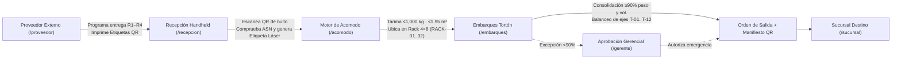

# Dokra-CDMX — Plataforma WMS de Almacén, Acomodo Inteligente y Embarques

`PHP ^8.3` · `Laravel ^13.17` · `Vite ^8` · `SQLite` · `NOM-036 / NOM-006`

Sistema web integral de gestión de almacenes (**WMS / ERP Logístico**) diseñado para operar un Centro de Distribución (**CEDIS**) de papelería en la Zona Metropolitana de la CDMX. Orquesta el flujo completo desde la cita de proveedores y el etiquetado QR, pasando por la recepción con escáner handheld, el motor predictivo de acomodo en racks **4×8** con bloqueos físicos **Poka-Yoke**, hasta la consolidación y despacho de camiones **Tortón (≥ 90%)** con cumplimiento normativo **NOM-036** y **NOM-006**.

---

## Tabla de Contenidos

- [Características Principales](#características-principales)
- [Flujo Operativo End-to-End](#flujo-operativo-end-to-end)
- [Perfiles y Control de Acceso (RBAC)](#perfiles-y-control-de-acceso-rbac)
- [Reglas Físicas, Topológicas y Normativas](#reglas-físicas-topológicas-y-normativas)
- [Catálogo Maestro y Estructura de Planta](#catálogo-maestro-y-estructura-de-planta)
- [Stack Tecnológico](#stack-tecnológico)
- [Instalación Local](#instalación-local)
  - [Requisitos](#requisitos)
  - [Pasos](#pasos)
  - [Verificación](#verificación)
- [Usuarios de Prueba](#usuarios-de-prueba)
- [Medidas de Seguridad y Tolerancia a Fallos (Fail-Safe)](#medidas-de-seguridad-y-tolerancia-a-fallos-fail-safe)
  - [Blindaje Topológico y Físico](#blindaje-topológico-y-físico)
  - [Control de Acceso y Sesiones (RBAC)](#control-de-acceso-y-sesiones-rbac)
  - [Manejo Controlado de Errores, Bitácoras y Contingencias](#manejo-controlado-de-errores-bitácoras-y-contingencias)
- [Estructura del Proyecto](#estructura-del-proyecto)
- [Pruebas Automatizadas](#pruebas-automatizadas)

---

## Características Principales

- **Motor de Acomodo Predictivo (`SlottingEngineService`):** calcula automáticamente en qué tarima y capa acomodar cada caja, anticipando llegadas programadas pendientes (*lookahead*) mediante ordenamiento canónico (`prioridad_zona ASC, densidad_master DESC, peso_bruto_master DESC`).
- **Guard Topológico y Normativo (`WarehouseSlottingTopologyGuard`):** bloquea en tiempo real violaciones de aislamiento entre sucursales, coordenadas fuera de rango, sobrepeso/sobrevolumen, aplastamiento vertical, mezcla de líquidos con papel higroscópico y faltas a NOM-036 / NOM-006.
- **Doble Etiquetado QR de Trazabilidad:**
  1. **Etiqueta QR del Proveedor:** 1 etiqueta principal del conjunto + 1 etiqueta individual por caja con datos de bulto, ASN, destino, SKU, piezas y peso.
  2. **Etiqueta Láser Interna del Operador:** generada al escanear cada bulto en recepción, indicando coordenada exacta de rack (`RACK-XX · N#·P#`), origen y andén/ola de salida.
- **Consolidación y Despacho de Camión Tortón (`OutboundOrderService`):** evalúa peso y volumen envolvente en vivo con candado normativo **≥ 90%**, calcula la secuencia de carga con **balanceo lateral de ejes** (posiciones `T-01` a `T-12`), libera posiciones del rack y promueve tarimas de Ola 2 a Ola 1.
- **Flujo de Salidas de Emergencia (< 90%):** permite a Embarques u Operación enviar alertas urgentes a Dirección General; cuando el Gerente aprueba, se dispara automáticamente la Orden de Salida real y su **Manifiesto de Embarque imprimible con código QR y sello/marchamo**.
- **Gestión de Catálogo y Usuarios:** alta dinámica de nuevos SKUs (con cálculo automático de densidad, zona vertical, grado ECT, camas operativas y nivel NOM-036) y administración de cuentas internas y externas por rol.

---

## Flujo Operativo End-to-End



---

## Perfiles y Control de Acceso (RBAC)

La aplicación exige autenticación individual por correo y contraseña (`EnsureUserHasRole`) y dirige a cada cuenta exclusivamente a su módulo operativo:

| Rol | Rutas Principales | Responsabilidades en la Plataforma |
| :--- | :--- | :--- |
| **`gerente`** | `/gerente` *(acceso transversal)* | Panel ejecutivo de los 32 racks y andenes, alta y activación/suspensión de usuarios internos/externos, aprobación o rechazo de salidas de emergencia (< 90%). |
| **`jefe_embarque`** | `/embarques`, `/acomodo` | Monitoreo de consolidación por sucursal priorizado por SLA, secuencia de carga balanceada por ejes, solicitud de emergencias y generación de órdenes/manifiestos de salida. |
| **`operador`** | `/recepcion`, `/acomodo` | Escaneo QR en andenes de entrada (`R1`–`R4`), recepción individual o por lote, armado de tarimas, ubicación en racks 4×8, impresión de etiquetas láser e ingreso de nuevos productos. |
| **`proveedor`** | `/proveedor`, `/acomodo/etiqueta-qr` | Programación de citas de entrega en andenes `R1`–`R4`, registro de productos en catálogo e impresión de etiquetas QR de conjunto y por caja. |
| **`sucursal`** | `/sucursal` | Consulta de estado de abastecimiento y recepción para la sucursal destino asignada (`SUC-01` a `SUC-32`). |

---

## Reglas Físicas, Topológicas y Normativas

| Categoría | Parámetro / Regla Implementada |
| :--- | :--- |
| **Aislamiento de Sucursales** | 1 rack exclusivo por sucursal (`SUC-01` → `RACK-01` hasta `SUC-32` → `RACK-32`); prohibido mezclar tarimas o avisos entre destinos. |
| **Topología de Rack** | Matriz de **4 Niveles (`N1`–`N4`) × 8 Posiciones (`P1`–`P8`) = 32 tarimas por rack** (1,024 ubicaciones totales). |
| **Poka-Yoke por Tarima** | Peso total máximo **1,000 kg** (incluye **22 kg** de tara de madera), volumen útil máximo **1.95 m³** (2.19 m³ brutos) y altura máxima **1.85 m** (incluye 0.15 m de base). |
| **Estiba Vertical y ECT** | Prohibido colocar carga pesada (Zona 1) encima de carga ligera/aplastable (Zona 3). Respeto estricto al límite de camas por resistencia **ECT** y tope operativo por peso. |
| **Segregación Química / Higroscópica** | Prohibido mezclar líquidos con papel higroscópico en la misma tarima y prohibido colocar tarimas con líquidos encima de papel higroscópico en la misma columna del rack. |
| **Regla Tortón (≥ 90%)** | Máximo **12 tarimas**, **12,000 kg** y **28.59 m³** por unidad. Candado mínimo del **90%** en peso (≥ 10,800 kg) y volumen (≥ 25.73 m³), salvo autorización gerencial auditable. |
| **NOM-036-1-STPS-2018** | Alertas ergonómicas por bulto (> 15 kg / > 20 kg), equipo auxiliar obligatorio para cajas > 25 kg y control acumulado por turno (**10,000 kg** en `<10 m` y **6,000 kg** en `10–20 m`). |
| **NOM-006-STPS-2023** | Confirmación obligatoria de maquinaria (apilador eléctrico / montacargas con operador DC-3) para estiba en niveles elevados (`N2`–`N4`). |

---

## Catálogo Maestro y Estructura de Planta

- **Catálogo Auditado (`StationeryCatalogSeeder`):** 72 SKUs reales de papelería clasificados por densidad, dimensiones máster, factor de empaque, resistencia ECT y perfil de riesgo:
  - **25 SKUs** en Zona 1 (*Base / Pesado*).
  - **38 SKUs** en Zona 2 (*Intermedio / Estándar*).
  - **9 SKUs** en Zona 3 (*Superior / Ligero*).
- **Andenes Operativos:** 4 andenes de recepción (`R1`, `R2`, `R3`, `R4`) y 3 andenes de embarque (`E1`, `E2`, `E3`) en ventana operativa de `08:00` a `18:00 h`.
- **Escenario Demo Pre-sembrado (`WmsDemoSeeder`):** incluye 4 sucursales con inventario y llegadas realistas (`SUC-01` y `SUC-03` listas para Tortón ≥ 90%, `SUC-02` con tarima abierta y llegadas predictivas, `SUC-04` lista para secuenciación automática por lote) más botón de reinicio rápido del escenario demo.

---

## Stack Tecnológico

| Capa | Tecnología declarada |
| :--- | :--- |
| **Backend** | PHP `^8.3` (recomendado `8.4`), Laravel `^13.17` (`laravel/framework`). |
| **Base de datos** | SQLite por defecto (`DB_CONNECTION=sqlite`); compatible con MySQL, MariaDB y PostgreSQL. |
| **Frontend** | Blade, Tailwind CSS (`@tailwindcss/vite` v4 / CDN), Alpine.js `3.14.8`, Font Awesome `6.5.1`, Vite `8`. |
| **QR y documentos** | `chillerlan/php-qrcode` `^6.0` (SVG en Base64) y `barryvdh/laravel-dompdf` `^3.1`. |
| **Calidad y testing** | PHPUnit `^12.5`, Laravel Pint `^1.27`. |

---

## Instalación Local

### Requisitos

| Componente | Versión / configuración declarada |
| :--- | :--- |
| PHP | `^8.3` (recomendado `8.4`) con extensión PDO SQLite habilitada. |
| Laravel | `^13.17` (`laravel/framework`). |
| Composer | Gestor de dependencias PHP (`composer.json`). |
| Node.js y npm | Requeridos por Vite `^8.0.0` y Tailwind CSS `^4.0.0`; verifica tu versión con `node -v` y `npm -v`. |
| Base de datos | SQLite por defecto (`DB_CONNECTION=sqlite` en `.env.example`). |

> Valores relevantes de `.env.example` para el entorno local: `APP_ENV=local`, `APP_DEBUG=true`, `APP_URL=http://localhost:8000`, `SESSION_DRIVER=database`, `CACHE_STORE=database`, `QUEUE_CONNECTION=database`, `LOG_CHANNEL=stack` y `LOG_LEVEL=debug`. Para producción, configura `APP_ENV=production` y `APP_DEBUG=false`.

### Pasos

1. Clona el repositorio y entra en la carpeta del proyecto:

   ```bash
   git clone <URL_DEL_REPOSITORIO> cedis-cdmx
   cd cedis-cdmx
   ```

2. Instala las dependencias de PHP:

   ```bash
   composer install
   ```

3. Crea el archivo de entorno y genera la clave de la aplicación:

   ```bash
   cp .env.example .env
   php artisan key:generate
   ```

4. Crea el archivo de base de datos SQLite:

   ```bash
   # Linux / macOS / Git Bash
   touch database/database.sqlite
   ```

   ```powershell
   # Windows PowerShell
   New-Item -ItemType File -Path database\database.sqlite -Force
   ```

5. Ejecuta las migraciones y siembra los datos demo:

   ```bash
   php artisan migrate --seed
   ```

   `DatabaseSeeder` ejecuta, en orden, `UserSeeder`, `BranchSeeder`, `StationeryCatalogSeeder` y `WmsDemoSeeder`. Las migraciones crean también las tablas de `users`, `sessions`, `cache` y `jobs`, necesarias porque el entorno de referencia usa controladores `database` para sesión, caché y colas.

6. Instala las dependencias de Node y compila los recursos frontend:

   ```bash
   npm install && npm run build
   ```

   Los scripts disponibles en `package.json` son `npm run build` (`vite build`) y `npm run dev` (`vite`).

7. Inicia el servidor de desarrollo:

   ```bash
   php artisan serve
   ```

### Verificación

Abre `http://localhost:8000` (valor de `APP_URL` en `.env.example`) e inicia sesión con alguna de las cuentas de la sección [Usuarios de Prueba](#usuarios-de-prueba).

---

## Usuarios de Prueba

Creados por `UserSeeder` durante `php artisan migrate --seed`:

| Rol | Nombre | Correo electrónico | Contraseña | Módulo principal |
| :--- | :--- | :--- | :--- | :--- |
| `gerente` | Lic. Roberto Peña | `gerente@cedis.com` | `Gerente#2026` | `/gerente` |
| `jefe_embarque` | Ing. Carlos Mendoza | `embarque@cedis.com` | `Embarque#2026` | `/embarques` |
| `operador` | Juan Pérez Gómez | `operador@cedis.com` | `Operador#2026` | `/recepcion` |
| `proveedor` | Distribuidora Metropolitana S.A. | `proveedor@cedis.com` | `Proveedor#2026` | `/proveedor` |
| `sucursal` | Mario Gómez Lara | `sucursal@cedis.com` | `Sucursal#2026` | `/sucursal` |

---

## Medidas de Seguridad y Tolerancia a Fallos (Fail-Safe)

La plataforma está diseñada para **detener la operación antes de persistir un dato inválido**, en lugar de corregirlo después. Las defensas combinan reglas de negocio rígidas, control de acceso por perfil, validación de entradas, transacciones de base de datos, bitácoras y un flujo de excepción gerencial.

### Blindaje Topológico y Físico

`app/Services/WarehouseSlottingTopologyGuard.php` concentra las validaciones críticas del CEDIS. Cada regla incumplida se registra como `WAREHOUSE_SLOTTING_TOPOLOGY_GUARD_BLOCKED` vía `Log::warning`, se guarda en el historial en memoria (`recentViolations()`) y se lanza como `InvalidArgumentException`; el controlador lo traduce a una respuesta **422** con el motivo exacto.

| Protección | Qué bloquea | Código de regla representativo |
| :--- | :--- | :--- |
| **Aislamiento por sucursal** | Mezclar tarimas o avisos de entrega (ASN) de una sucursal en el rack exclusivo de otra; rack fuera de `RACK-01`…`RACK-32`. | `BRANCH_ISOLATION_ARRIVAL_MISMATCH`, `BRANCH_ISOLATION_PALLET_MISMATCH`, `TOPOLOGY_INVALID_BRANCH_RACK` |
| **Topología 4×8** | Coordenadas fuera de `N1`–`N4` / `P1`–`P8`, posiciones ya ocupadas y racks con las 32 tarimas llenas. | `TOPOLOGY_COORDINATE_OUT_OF_BOUNDS`, `TOPOLOGY_COORDINATE_OCCUPIED`, `TOPOLOGY_RACK_CAPACITY_EXCEEDED` |
| **Poka-Yoke de tarima** | Sobrepeso **> 1,000 kg** (incluye 22 kg de tara), sobrevolumen **> 1.95 m³** y sobrealtura **> 1.85 m**. | `POKA_YOKE_WEIGHT_EXCEEDED`, `POKA_YOKE_VOLUME_EXCEEDED`, `POKA_YOKE_HEIGHT_EXCEEDED` |
| **Segregación de materiales** | Líquidos sobre papel higroscópico —o viceversa— en la misma tarima y en la misma columna del rack. | `INCOMPATIBLE_LIQUID_ON_HYGROSCOPIC_PALLET`, `RACK_COLUMN_LIQUID_OVER_HYGROSCOPIC` |
| **Integridad de estiba** | Carga pesada (Zona 1) sobre carga ligera (Zona 3) y exceso de camas permitidas por resistencia **ECT**. | `VERTICAL_STACKING_CRUSH_HAZARD`, `ECT_LAYER_LIMIT_EXCEEDED` |
| **NOM-036-1-STPS-2018** | Cajas **> 25 kg** sin confirmar equipo auxiliar y rebasar la cuota diaria por turno (**10,000 kg** en `<10 m`, **6,000 kg** en `10–20 m`). Las alertas ergonómicas operativas consideran también bultos > 15 kg / > 20 kg. | `NOM036_AUXILIARY_EQUIPMENT_REQUIRED`, `NOM036_DAILY_SHIFT_QUOTA_EXCEEDED` |
| **NOM-006-STPS-2023** | Estiba en niveles `N2`–`N4` sin confirmar apilador eléctrico / montacargas con operador DC-3. | `NOM006_UPPER_LEVEL_MACHINERY_REQUIRED` |
| **Candado Tortón** | Despacho por debajo del **90%** de peso y volumen sin autorización gerencial, exceso de 12 tarimas / 12,000 kg / 28.59 m³ y ausencia de motivo auditable. | `InvalidArgumentException` desde `OutboundOrderService` |

Además, el escaneo QR en recepción rechaza etiquetas malformadas, **bultos duplicados**, SKUs ausentes del catálogo maestro, destinos fuera de `SUC-01`…`SUC-32` y excedentes sobre las cajas declaradas en el ASN; cada caso devuelve **422** en lugar de generar inventario inconsistente.

### Control de Acceso y Sesiones (RBAC)

| Mecanismo | Implementación | Efecto fail-safe |
| :--- | :--- | :--- |
| **Autenticación obligatoria** | Todas las rutas operativas están dentro de `Route::middleware('auth')` en `routes/web.php`; el login es exclusivamente por correo y contraseña. | Un visitante no autenticado es redirigido a `/login`. |
| **Aislamiento estricto por rol** | Alias `role` registrado en `bootstrap/app.php` y aplicado ruta por ruta mediante `EnsureUserHasRole`. | Una cuenta solo ve su módulo; intentar otra ruta devuelve **403** en JSON (`expectsJson`) o redirige al dashboard propio con un aviso. |
| **Cambio de perfil** | Mensaje y flujo de `AuthController::logout()`: `Auth::logout()`, `session()->invalidate()` y `regenerateToken()`. | Para cambiar de perfil es obligatorio **cerrar sesión e iniciar con la cuenta correspondiente**; no existe cambio de rol en caliente. |
| **Protección CSRF** | Formularios Blade con `@csrf` (login y logout) y token inyectado en las vistas Alpine (`csrfToken: @js(csrf_token())`). | Las peticiones POST/PATCH sin token válido son rechazadas por el middleware web de Laravel. |
| **Cuentas suspendidas** | `AuthController` comprueba `is_active` después de `Auth::attempt()`; el gerente no puede suspenderse a sí mismo en `UserManagementController`. | La sesión se invalida inmediatamente y se muestra un error; siempre queda al menos una cuenta gerencial activa. |
| **Hashing y ocultamiento** | `App\Models\User` usa el cast `password => hashed`, oculta `password` y `remember_token`, y normaliza correo/RFC. | Las credenciales nunca se exponen en respuestas JSON ni se almacenan en texto plano. |
| **Respuestas coherentes** | `Exceptions::shouldRenderJsonWhen(...)` en `bootstrap/app.php` para `api/*` o peticiones `expectsJson()`. | Errores y mensajes de acceso se devuelven como JSON cuando el cliente lo solicita. |

### Manejo Controlado de Errores, Bitácoras y Contingencias

| Situación | Respuesta de la plataforma |
| :--- | :--- |
| **Datos de entrada inválidos** | `validate()` en los controladores (`exists`, `in`, `min`, `max`, `unique`, `required_if`) devuelve **422** con errores por campo antes de tocar la base de datos. |
| **Violación de regla de negocio** | `try/catch (InvalidArgumentException)` en `SlottingController` y `EmergencyDispatchController` convierte el bloqueo del Guard, del motor de acomodo o del despacho en un mensaje operativo **422**, sin caída ni stack trace al usuario. |
| **Escrituras parciales** | `DB::transaction(...)` en `SlottingEngineService::receiveBoxes()` y `OutboundOrderService::dispatchOutboundOrder()` agrupa creación de tarimas, items, actualización de pesos/volúmenes, liberación de coordenadas `N×P`, promoción de Ola 2 a Ola 1 y generación de la orden. Si falla una regla, se revierte todo el ciclo. |
| **Auditoría de bloqueos** | Cada violación queda en `Log::warning('WAREHOUSE_SLOTTING_TOPOLOGY_GUARD_BLOCKED', ...)` con `rule_code`, mensaje, contexto y timestamp, además del historial consultable de la solicitud. |
| **Incidencias en andén** | El tablero muestra la bitácora de incidencias de recepción de `app/Support/CedisDemoData.php` (por ejemplo `INC-2026-041` excedente de cajas, `INC-2026-040` SKU no registrado, `INC-2026-039` tarima de 1.94 m reacomodada antes de ingresar). |
| **Salida de emergencia (< 90%)** | `EmergencyDispatchController` crea una solicitud `EMG-2026-###` en estado `pending` con motivo, andén, placa, chofer y solicitante; solo Gerencia puede aprobarla o rechazarla, y no se procesa dos veces (`422` si ya fue atendida). |
| **Aprobación auditada** | Al aprobar se exige tarimas ubicadas, se construye el motivo `EMERGENCIA … AUTORIZADA POR …`, se registra `reviewed_by_user_id`, `reviewed_at`, `manager_notes` y `outbound_order_id`, se dispara la Orden de Salida y se genera el manifiesto con QR y sello/marchamo. |
| **Folios sin colisión** | Los folios `SAL-2026-###` y `EMG-2026-###` se calculan con el máximo `id` y se reintentan mientras ya existan, evitando sobrescribir registros por concurrencia. |
| **Rearme del escenario** | El botón de reinicio rápido (`/acomodo/reiniciar-demo`) permite volver a un estado demo conocido tras una prueba fallida, sin editar la base de datos manualmente. |

> Estas medidas cubren errores funcionales y de manipulación. En producción deben complementarse con `APP_DEBUG=false`, HTTPS, copias de seguridad de `database/database.sqlite` y control de acceso al servidor.

---

## Estructura del Proyecto

| Ruta | Descripción |
| :--- | :--- |
| `app/` | Código PHP de la aplicación (autoload PSR-4 `App\`). |
| `app/Services/` | `SlottingEngineService`, `WarehouseSlottingTopologyGuard` y `OutboundOrderService`: motor, blindaje y despacho. |
| `app/Http/Middleware/`, `app/Http/Controllers/` | Control de acceso por rol y controladores de autenticación, acomodo, usuarios y emergencias. |
| `bootstrap/app.php` | Registro del alias `role`, proxies de confianza y renderizado JSON de excepciones. |
| `database/factories/`, `database/seeders/` | Fábricas y seeders, incluidos los usuarios de prueba (PSR-4 `Database\Factories\` y `Database\Seeders\`). |
| `database/database.sqlite` | Base de datos SQLite local creada durante la instalación. |
| `routes/` | Definición de rutas web protegidas por `auth` y `role`; comandos de consola. |
| `tests/` | Pruebas automatizadas (autoload PSR-4 `Tests\`). |
| `composer.json`, `package.json`, `.env.example` | Dependencias, scripts de compilación y configuración de entorno de referencia. |

---

## Pruebas Automatizadas

El script `composer test` ejecuta `php artisan config:clear` y luego `php artisan test` con PHPUnit `^12.5`:

```bash
composer test
```
