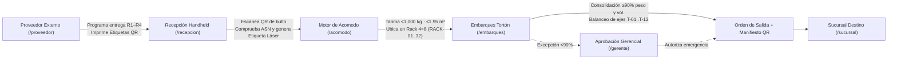

# Dokra-CDMX -Plataforma WMS de Almacén, Acomodo Inteligente y Embarques

`PHP ^8.3` · `Laravel ^13.17` · `Vite ^8` · `SQLite` · `NOM-036 / NOM-006`

Sistema web integral de gestión de almacenes (**WMS / ERP Logístico**) diseñado para operar un Centro de Distribución (**CEDIS**) de papelería en la Zona Metropolitana de la CDMX. Orquesta el flujo completo desde la cita de proveedores y el etiquetado QR, pasando por la recepción con escáner handheld, el motor predictivo de acomodo en racks **4×8** con bloqueos físicos **Poka-Yoke**, hasta la consolidación y despacho de camiones **Tortón (≥ 90%)** con cumplimiento normativo **NOM-036** y **NOM-006**.

---

## Tabla de Contenidos

- [Características Principales](#características-principales)
- [Flujo Operativo End-to-End](#flujo-operativo-end-to-end)
- [Perfiles y Control de Acceso (RBAC)](#perfiles-y-control-de-acceso-rbac)
- [Reglas Físicas, Topológicas y Normativas](#reglas-físicas-topológicas-y-normativas)
- [Catálogo Maestro y Estructura de Planta](#catálogo-maestro-y-estructura-de-planta)
- [Stack Tecnológico](#stack-tecnológico)
- [Instalación Local](#instalación-local)
  - [Requisitos](#requisitos)
  - [Pasos](#pasos)
  - [Verificación](#verificación)
- [Usuarios de Prueba](#usuarios-de-prueba)
- [Estructura del Proyecto](#estructura-del-proyecto)
- [Pruebas Automatizadas](#pruebas-automatizadas)

---

## Características Principales

- **Motor de Acomodo Predictivo (`SlottingEngineService`):** Calcula automáticamente en qué tarima y capa acomodar cada caja, anticipando llegadas programadas pendientes (*lookahead*) mediante ordenamiento canónico (`prioridad_zona ASC, densidad_master DESC, peso_bruto_master DESC`).
- **Guard Topológico y Normativo (`WarehouseSlottingTopologyGuard`):** Bloquea en tiempo real violaciones de aislamiento entre sucursales, coordenadas fuera de rango, sobrepeso/sobrevolumen, aplastamiento vertical, mezcla de líquidos con papel higroscópico y faltas a NOM-036 / NOM-006.
- **Doble Etiquetado QR de Trazabilidad:**
  1. **Etiqueta QR del Proveedor:** 1 etiqueta principal del conjunto + 1 etiqueta individual por caja con datos de bulto, ASN, destino, SKU, piezas y peso.
  2. **Etiqueta Láser Interna del Operador:** Generada al escanear cada bulto en recepción, indicando coordenada exacta de rack (`RACK-XX · N#·P#`), origen y andén/ola de salida.
- **Consolidación y Despacho de Camión Tortón (`OutboundOrderService`):** Evalúa peso y volumen envolvente en vivo con candado normativo **≥ 90%**, calcula la secuencia de carga con **balanceo lateral de ejes** (posiciones `T-01` a `T-12`), libera posiciones del rack y promueve tarimas de Ola 2 a Ola 1.
- **Flujo de Salidas de Emergencia (< 90%):** Permite a Embarques u Operación enviar alertas urgentes a Dirección General; cuando el Gerente aprueba, se dispara automáticamente la Orden de Salida real y su **Manifiesto de Embarque imprimible con código QR y sello/marchamo**.
- **Gestión de Catálogo y Usuarios:** Alta dinámica de nuevos SKUs (con cálculo automático de densidad, zona vertical, grado ECT, camas operativas y nivel NOM-036) y administración de cuentas internas y externas por rol.

---

## Flujo Operativo End-to-End



---

## Perfiles y Control de Acceso (RBAC)

La aplicación exige autenticación individual por correo y contraseña (`EnsureUserHasRole`) y dirige a cada cuenta exclusivamente a su módulo operativo:

| Rol | Rutas Principales | Responsabilidades en la Plataforma |
| :--- | :--- | :--- |
| **`gerente`** | `/gerente` *(acceso transversal)* | Panel ejecutivo de los 32 racks y andenes, alta y activación/suspensión de usuarios internos/externos, aprobación o rechazo de salidas de emergencia (< 90%). |
| **`jefe_embarque`** | `/embarques`, `/acomodo` | Monitoreo de consolidación por sucursal priorizado por SLA, secuencia de carga balanceada por ejes, solicitud de emergencias y generación de órdenes/manifiestos de salida. |
| **`operador`** | `/recepcion`, `/acomodo` | Escaneo QR en andenes de entrada (`R1`–`R4`), recepción individual o por lote, armado de tarimas, ubicación en racks 4×8, impresión de etiquetas láser e ingreso de nuevos productos. |
| **`proveedor`** | `/proveedor`, `/acomodo/etiqueta-qr` | Programación de citas de entrega en andenes `R1`–`R4`, registro de productos en catálogo e impresión de etiquetas QR de conjunto y por caja. |
| **`sucursal`** | `/sucursal` | Consulta de estado de abastecimiento y recepción para la sucursal destino asignada (`SUC-01` a `SUC-32`). |

---

## Reglas Físicas, Topológicas y Normativas

| Categoría | Parámetro / Regla Implementada |
| :--- | :--- |
| **Aislamiento de Sucursales** | 1 rack exclusivo por sucursal (`SUC-01` → `RACK-01` hasta `SUC-32` → `RACK-32`); prohibido mezclar tarimas o avisos entre destinos. |
| **Topología de Rack** | Matriz de **4 Niveles (`N1`–`N4`) × 8 Posiciones (`P1`–`P8`) = 32 tarimas por rack** (1,024 ubicaciones totales). |
| **Poka-Yoke por Tarima** | Peso total máximo **1,000 kg** (incluye **22 kg** de tara de madera), volumen útil máximo **1.95 m³** (2.19 m³ brutos) y altura máxima **1.85 m** (incluye 0.15 m de base). |
| **Estiba Vertical y ECT** | Prohibido colocar carga pesada (Zona 1) encima de carga ligera/aplastable (Zona 3). Respeto estricto al límite de camas por resistencia **ECT** y tope operativo por peso. |
| **Segregación Química / Higroscópica** | Prohibido mezclar líquidos con papel higroscópico en la misma tarima y prohibido colocar tarimas con líquidos encima de papel higroscópico en la misma columna del rack. |
| **Regla Tortón (≥ 90%)** | Máximo **12 tarimas**, **12,000 kg** y **28.59 m³** por unidad. Candado mínimo del **90%** en peso (≥ 10,800 kg) y volumen (≥ 25.73 m³), salvo autorización gerencial auditable. |
| **NOM-036-1-STPS-2018** | Alertas ergonómicas por bulto (> 15 kg / > 20 kg), equipo auxiliar obligatorio para cajas > 25 kg y control acumulado por turno (**10,000 kg** en `<10 m` y **6,000 kg** en `10–20 m`). |
| **NOM-006-STPS-2023** | Confirmación obligatoria de maquinaria (apilador eléctrico / montacargas con operador DC-3) para estiba en niveles elevados (`N2`–`N4`). |

---

## Catálogo Maestro y Estructura de Planta

- **Catálogo Auditado (`StationeryCatalogSeeder`):** 72 SKUs reales de papelería clasificados por densidad, dimensiones máster, factor de empaque, resistencia ECT y perfil de riesgo:
  - **25 SKUs** en Zona 1 (*Base / Pesado*)
  - **38 SKUs** en Zona 2 (*Intermedio / Estándar*)
  - **9 SKUs** en Zona 3 (*Superior / Ligero*)
- **Andenes Operativos:** 4 andenes de recepción (`R1`, `R2`, `R3`, `R4`) y 3 andenes de embarque (`E1`, `E2`, `E3`) en ventana operativa de `08:00` a `18:00 h`.
- **Escenario Demo Pre-sembrado (`WmsDemoSeeder`):** Incluye 4 sucursales con inventario y llegadas realistas (`SUC-01` y `SUC-03` listas para Tortón ≥ 90%, `SUC-02` con tarima abierta y llegadas predictivas, `SUC-04` lista para secuenciación automática por lote) más botón de reinicio rápido del escenario demo.

---

## Stack Tecnológico

- **Backend:** PHP `^8.3` (recomendado `8.4`), Laravel `^13.17`
- **Base de Datos:** SQLite (configurado por defecto para despliegue inmediato) / compatible con MySQL, MariaDB y PostgreSQL
- **Frontend:** Blade, Tailwind CSS (`@tailwindcss/vite` v4 / CDN), Alpine.js `3.14.8`, Font Awesome `6.5.1`, Vite `8`
- **Códigos QR y Documentos:** `chillerlan/php-qrcode` `^6.0` (SVG en Base64) y `barryvdh/laravel-dompdf` `^3.1`
- **Calidad y Testing:** PHPUnit `^12.5`, Laravel Pint `^1.27`

---

## Instalación Local

### Requisitos

| Componente | Versión / configuración declarada |
| :--- | :--- |
| PHP | `^8.3` (recomendado `8.4`) |
| Laravel | `^13.17` (`laravel/framework`) |
| Composer | Gestor de dependencias PHP (`composer.json`) |
| Node.js y npm | Requeridos por Vite `^8.0.0` y Tailwind CSS `^4.0.0`; verifica tu versión con `node -v` y `npm -v` |
| Base de datos | SQLite por defecto (`DB_CONNECTION=sqlite` en `.env.example`) |

### Pasos

1. Clona el repositorio y entra en la carpeta del proyecto:

   ```bash
   git clone <URL_DEL_REPOSITORIO> cedis-cdmx
   cd cedis-cdmx
   ```

2. Instala las dependencias de PHP:

   ```bash
   composer install
   ```

3. Crea el archivo de entorno y genera la clave de la aplicación:

   ```bash
   cp .env.example .env
   php artisan key:generate
   ```

4. Crea el archivo de base de datos SQLite:

   ```bash
   # Linux / macOS / Git Bash
   touch database/database.sqlite
   ```

   ```powershell
   # Windows PowerShell
   New-Item -ItemType File -Path database\database.sqlite -Force
   ```

5. Ejecuta las migraciones y siembra los datos demo:

   ```bash
   php artisan migrate --seed
   ```

6. Instala las dependencias de Node y compila los recursos frontend:

   ```bash
   npm install && npm run build
   ```

7. Inicia el servidor de desarrollo:

   ```bash
   php artisan serve
   ```

### Verificación

Abre `http://localhost:8000` (valor de `APP_URL` en `.env.example`) e inicia sesión con alguna de las cuentas de la sección [Usuarios de Prueba](#usuarios-de-prueba).

---

## Usuarios de Prueba

Creados por `UserSeeder` durante `php artisan migrate --seed`:

| Rol | Nombre | Correo electrónico | Contraseña | Módulo principal |
| :--- | :--- | :--- | :--- | :--- |
| `gerente` | Lic. Roberto Peña | `gerente@cedis.com` | `Gerente#2026` | `/gerente` |
| `jefe_embarque` | Ing. Carlos Mendoza | `embarque@cedis.com` | `Embarque#2026` | `/embarques` |
| `operador` | Juan Pérez Gómez | `operador@cedis.com` | `Operador#2026` | `/recepcion` |
| `proveedor` | Distribuidora Metropolitana S.A. | `proveedor@cedis.com` | `Proveedor#2026` | `/proveedor` |
| `sucursal` | Mario Gómez Lara | `sucursal@cedis.com` | `Sucursal#2026` | `/sucursal` |

---

## Estructura del Proyecto

| Ruta | Descripción |
| :--- | :--- |
| `app/` | Código PHP de la aplicación (autoload PSR-4 `App\`). |
| `database/factories/`, `database/seeders/` | Fábricas y seeders, incluidos los usuarios de prueba (PSR-4 `Database\Factories\` y `Database\Seeders\`). |
| `database/database.sqlite` | Base de datos SQLite local creada durante la instalación. |
| `tests/` | Pruebas automatizadas (autoload PSR-4 `Tests\`). |
| `composer.json`, `package.json`, `.env.example` | Dependencias, scripts de compilación y configuración de entorno de referencia. |

---

## Pruebas Automatizadas

El script `composer test` ejecuta `php artisan config:clear` y luego `php artisan test` con PHPUnit `^12.5`:

```bash
composer test
```
